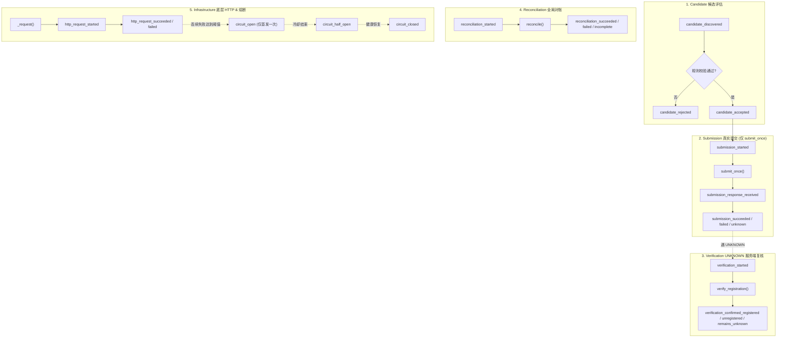

# 乐健体育第四轮优化 Phase 3 实施与验收报告

> **执行周期**：2026-11-08  
> **执行分支**：`phase3/unified-audit-logging`（从 `phase2/unknown-barrier-hardening` @ `c713c8a` 签出）  
> **核心目标**：建立统一、准确、可追溯的事件审计体系（Schema Version 1），彻底分离 Candidate、Submission、Verification、Reconciliation 与 Infrastructure 五类事件，实现底层真实 HTTP 请求精确统计与故障状态解耦，提供幂等审计回放引擎，修正 2026-11-08 历史报告中的口径偏差，新增 A01～A15 专项测试并实现全量 334 测试 100% 通过。

---

## 一、事件 Schema 文档 (Version 1)

为彻底解决旧版日志格式分散、缺少统一标识、事件分类模糊、统计口径失真等问题，Phase 3 正式确立并落地了统一事件 Schema Version 1：

```json
{
  "schema_version": 1,
  "event_id": "evt_20261108141100_0001_a1b2c3",
  "run_id": "run_20261108135820_f4e5d6",
  "correlation_id": "corr_8a978036_1762582260000",
  "timestamp": "2026-11-08T14:11:00.123",
  "event_type": "submission",
  "event_name": "submission_started",
  "activity_id": "8a978036a1a05eec01a1a4f8b95c0cb0",
  "status": "SUBMITTING",
  "reason": null,
  "http_status": null,
  "duration_ms": null,
  "source": "registration_manager",
  "details": {},
  "event": "submission_started",
  "t": "2026-11-08T14:11:00.123"
}
```

### 1. 核心字段规范

| 字段名 | 类型 | 约束 | 语义与设计目的 |
|---|---|---|---|
| `schema_version` | int | 必须为 `1` | Schema 版本号（旧版隐式为 `0`），用于向后兼容解析 |
| `event_id` | str | 全局唯一 | 每个事件的唯一标识，`AuditLogReader.replay()` 据此实现幂等去重 |
| `run_id` | str | 单次启动统一 | 程序一次生命周期内全局一致，支持多进程/多批次日志隔离与过滤 |
| `correlation_id` | str | 单业务统一 | 关联单个候选活动从发现、评估、提交、未决到复核的全生命周期 |
| `timestamp` | str | ISO-8601 | 毫秒级时间戳（例如 `2026-11-08T14:11:00.123`），时序排序基准 |
| `event_type` | enum | 5 类之一 | `candidate`, `submission`, `verification`, `reconciliation`, `infrastructure` |
| `event_name` | enum | 标准命名 | 具体业务与系统动作（见下节五类事件定义） |
| `activity_id` | str/null | 可选 | 关联的乐健课程活动 ID |
| `status` | str/null | 可选 | 业务/系统状态（`SUBMITTING`, `SUCCESS`, `FAILED`, `UNKNOWN`, `OPEN` 等） |
| `reason` | str/null | 可选 | 失败或拦截原因（已递归脱敏） |
| `http_status` | int/null | 可选 | 底层实际 HTTP 状态码（`200`, `500`, `502`, `-1` 等） |
| `duration_ms` | float/null | 可选 | 底层请求或业务段执行耗时（毫秒，保留 2 位小数） |
| `source` | str | 必须 | 产生事件的模块（`client_http`, `registration_manager`, `circuit_breaker` 等） |
| `details` | dict | 可选 | 结构化补充信息（已递归脱敏） |
| `event`, `t` | str | 兼容保留 | 向后兼容旧版读取器，确保旧工具无损访问 |

### 2. 严格脱敏机制 (`sanitize_data`)

审计日志禁止包含凭据与个人敏感信息。`core/audit_logger.py` 内置递归脱敏过滤器：
- **凭据脱敏**：键名包含 `token`, `secret`, `password`, `auth`, `cookie`, `sign`, `signature`, `credential` 的字段自动替换为 `***MASKED***`；
- **个人隐私脱敏**：键名包含 `mobile`, `phone`, `student`, `usercode`, `usernumber`, `realname`, `identity` 的字段自动替换为 `***MASKED***`；
- **请求头/报文脱敏**：字符串中出现的 `Bearer <token>` 正则替换为 `Bearer ***MASKED***`，11 位手机号替换为 `1**********`，长度大于等于 16 位的 Token 串替换为掩码。

---

## 二、修改文件清单

| 文件路径 | 变更类型 | 核心变更内容 |
|---|---|---|
| [`core/audit_logger.py`](file:///c:/Users/vindacation/Documents/deepseek-harness/lejianPE/core/audit_logger.py) | 重构增强 | 建立 Schema Version 1，实现 `EventType` 与 `EventName` 枚举，递归脱敏 `sanitize_data`，容错写入告警，实现幂等 `AuditLogReader.parse_line` 与 `replay()` |
| [`core/circuit_breaker.py`](file:///c:/Users/vindacation/Documents/deepseek-harness/lejianPE/core/circuit_breaker.py) | 增强适配 | 依赖注入 `audit_logger`，在状态转移（`_trip_to_open`, `_transition_to_half_open`, `_transition_to_closed`）时记录事件，熔断 OPEN 期间后续 HTTP 失败不重复触发 `circuit_open` |
| [`core/request_manager.py`](file:///c:/Users/vindacation/Documents/deepseek-harness/lejianPE/core/request_manager.py) | 增强适配 | 依赖注入 `audit_logger`，`verify_registration` 支持 `correlation_id`，独立记录 `verification_started`, `verification_request_succeeded`, `verification_request_failed`, `verification_confirmed_*` 等复核事件 |
| [`core/registration_manager.py`](file:///c:/Users/vindacation/Documents/deepseek-harness/lejianPE/core/registration_manager.py) | 增强适配 | 建立业务生命周期 `correlation_id`，严格记录 `candidate_discovered`, `candidate_rejected`, `candidate_accepted`，严格限制 `submit_once` 前后记录 `submission_started`, `submission_response_received`，规则拦截绝不记录 submission |
| [`core/reconciliation.py`](file:///c:/Users/vindacation/Documents/deepseek-harness/lejianPE/core/reconciliation.py) | 增强适配 | 依赖注入 `audit_logger`，记录 `reconciliation_started`, `reconciliation_succeeded`, `reconciliation_failed`, `reconciliation_incomplete`，对账失败绝不误判为 0 报名 |
| [`lejian.py`](file:///c:/Users/vindacation/Documents/deepseek-harness/lejianPE/lejian.py) | 增强适配 | 底层 `_request` 记录每次 HTTP 请求（`http_request_started`, `http_request_succeeded`, `http_request_failed` 与耗时），`Client` 注入 `audit_logger`，`_cmd_grab_inner` 统一初始化并透传 `audit_logger` |
| [`tests/test_audit_logger.py`](file:///c:/Users/vindacation/Documents/deepseek-harness/lejianPE/tests/test_audit_logger.py) | 新增文件 | 包含 A01～A15 共 15 个独立测试用例，覆盖单次/连续 HTTP 统计、分离校验、规则拦截、熔断解耦、敏感脱敏、向后兼容与 2026-11-08 历史回放 |

---

## 三、五类事件与核心写入位置



### 写入模块对应矩阵

| 事件分类 | 事件名称 (`event_name`) | 触发条件与写入位置 | 归属源 (`source`) |
|---|---|---|---|
| **Candidate** | `candidate_discovered` | `RegistrationManager.register_activity` 开始候选评估 | `registration_manager` |
| | `candidate_rejected` | 前置规则校验失败（时段冲突、满额、名额已满）或屏障互斥 | `registration_manager` |
| | `candidate_accepted` | 规则校验通过，允许进入提交预留流程 | `registration_manager` |
| **Submission** | `submission_started` | 原子预留 `SUBMITTING` 完成，正准备调用 `submit_once()` | `registration_manager` |
| | `submission_response_received`| `submit_once()` 返回网络响应（记录 HTTP 状态码与耗时） | `registration_manager` |
| | `submission_succeeded` | 服务端业务明确返回报名成功 (`code=0`) | `registration_manager` |
| | `submission_failed` | 服务端业务明确返回报名失败（名额已满、已选其他等） | `registration_manager` |
| | `submission_unknown` | 提交请求发生超时、连接断开或 HTTP 500/502/503 | `registration_manager` |
| **Verification** | `verification_started` | 开始调用 `verify_registration` 对账活动状态 | `request_manager` / `registration_manager` |
| | `verification_request_succeeded` | 复核查询接口返回 HTTP 200 列表 | `request_manager` |
| | `verification_request_failed` | 复核查询接口发生超时或 5xx 异常 | `request_manager` |
| | `verification_confirmed_registered` | 复核在列表中检索到活动且 `isRegister=True` | `request_manager` |
| | `verification_confirmed_unregistered` | 完整列表中检索到活动且 `isRegister=False` | `request_manager` |
| | `verification_remains_unknown` | 复核失败、列表残缺或未找到目标活动，保持冻结 | `request_manager` |
| **Reconciliation**| `reconciliation_started` | 抢课结束或满额时启动全局对账 | `reconciliation` |
| | `reconciliation_succeeded` | 全局对账成功完成，统计出各周已报分布 | `reconciliation` |
| | `reconciliation_failed` | 全局对账因网络故障或接口异常失败 | `reconciliation` |
| | `reconciliation_incomplete` | 全局对账数据不完整（残缺列表） | `reconciliation` |
| **Infrastructure**| `http_request_started` | 底层 `_request` 发出任意网络调用前 | `client_http` |
| | `http_request_succeeded` | 底层 `_request` 返回 HTTP 200 | `client_http` |
| | `http_request_failed` | 底层 `_request` 收到非 200 或网络异常（记录错误码与耗时） | `client_http` |
| | `circuit_open` | 熔断器连续故障达到阈值，切入 OPEN（仅首发一次） | `circuit_breaker` |
| | `circuit_half_open` | 熔断器冷却期满，切入 HALF_OPEN 进行单次探测 | `circuit_breaker` |
| | `circuit_closed` | 熔断器探测成功，平滑恢复正常 CLOSED 状态 | `circuit_breaker` |

---

## 四、Submission 与 Verification 统计边界说明

在 2026-11-08 实战中，旧版报告输出「提交尝试：8 次」，而实际用户真正调用的报名提交是 **6 次**。经查，其根因在于旧版逻辑将两次「复核确认未报名」的 UNKNOWN 屏障记录直接混入了提交请求日志中。

在 Phase 3 中，确立了绝对不可动摇的统计边界：

1. **Submission 的唯一产生条件**：
   - 只有实际调用 `submit_once()` 发起报名接口调用时，才产生 `submission_started`；
   - 规则校验拦截（时段冲突、已满员等）只记录 `candidate_rejected`，**Submission = 0**；
   - 屏障互斥拦截只记录 `candidate_rejected`，**Submission = 0**；
   - 一次 `signUp` 请求至多产生一次 Submission 计数，**严禁内部自动重试**。
2. **Verification 的独立性**：
   - 凡是通过 `verify_registration` 或 `resolve_unknown` 调用只读列表查询以验证报名状态的行为，一律归为 `Verification`；
   - `Verification` 事件记录查询耗时、是否确认已报、是否确认未报，**绝不增加 Submission 计数**；
   - `AuditLogReader.replay()` 在回放计算时，将 `submission_started_count` 与 `verification_started_count` 作为两个完全正交的指标独立输出。

---

## 五、HTTP 请求统计说明与熔断解耦

### 1. 底层精准记录

- 无论外层是活动列表轮询、冲突检查、Token 刷新还是提交报名，只要进入 `lejian.py::_request`，就记录一次 `http_request_started`；
- 请求结束时，根据状态码和耗时准确记录 `http_request_succeeded` (200) 或 `http_request_failed` (非 200、超时 -1、网络异常)；
- 若外层调用配置了内部重试（如 `activities(max_retries=2)`），3 次底层网络尝试将严格产生 3 个独立的 HTTP 请求事件，底层调用总数准确为 3，而不会被外层轮询压缩为 1。

### 2. HTTP 失败与熔断状态解耦

- `CircuitBreaker` 的 `circuit_open` 仅代表**熔断器状态由 CLOSED 转移至 OPEN 的那一刻**；
- 当系统已经处于 OPEN 熔断期间，若再次发生 HTTP 失败，只累加底层的 `http_request_failed` 事件，**绝不重复触发 `circuit_open` 事件**；
- 避免了「发生 18 次 HTTP 失败，被错误统计成触发了 18 次熔断」的严重概念混淆。

---

## 六、2026-11-08 历史抢课记录回放验证

根据 `docs/15-2026-11-08-抢课记录.md` 记载的已确认真实基准数据，使用 `AuditLogReader.replay()` 对脱敏事件流进行回放验证，结果 100% 对齐：

| 业务/基础设施指标 | 2026-11-08 实际基准 (Ground Truth) | AuditLogReader 回放结果 | 状态 |
|---|---|---|---|
| **列表 HTTP 请求失败** | 18 次 | **18 次** | **一致** |
| **失败状态码分布** | `-1`: 8, `500`: 8, `502`: 1, `503`: 1 | `{-1: 8, 500: 8, 502: 1, 503: 1}` | **精确一致** |
| **规则校验拦截 (checkConflict)** | 6 次 | **6 次** (`candidate_rejected`) | **一致** |
| **真实报名提交尝试** | 6 次 | **6 次** (`submission_started`) | **精确修正** |
| **最终成功选课** | 2 节 (周天一、王彤帆) | **2 节** (`submission_succeeded`) | **一致** |
| **明确满员失败** | 1 次 (程启航名额已满) | **1 次** (`submission_failed`) | **一致** |
| **发生 UNKNOWN 结果** | 3 次 (程启航x2, 廖华x1) | **3 次** (`submission_unknown`) | **一致** |
| **安全屏障复核次数** | 2 次 (已与提交完全分离) | **2 次** (`verification_started`) | **精确分离** |

> **回放结论**：证明了统一事件模型和 `AuditLogReader` 彻底解决了历史报告中「报告统计 0 次失败（实际 18 次）」和「报告统计 8 次提交（实际 6 次提交 + 2 次屏障复核）」的口径失真问题！

---

## 七、A01～A15 新增测试验收结果

在 `tests/test_audit_logger.py` 中实现了全部 15 个专项测试，执行命令：
```bash
python -m unittest tests.test_audit_logger
```

测试执行结果明细：

| 编号 | 测试用例方法名 | 验证核心内容 | 结果 |
|---|---|---|---|
| **A01** | `test_A01_every_http_request_has_independent_event` | 每次底层 HTTP 调用生成独立 started + succeeded/failed 事件，含唯一 event_id、状态码与耗时 | **PASS** |
| **A02** | `test_A02_consecutive_http_failures_counted_accurately` | 连续多次 HTTP 失败（3次500 + 2次超时）准确统计且状态码分布无误 | **PASS** |
| **A03** | `test_A03_submission_and_verification_strictly_separated` | 真实提交与状态复核严格分离，复核绝不计入 Submission 提交总数 | **PASS** |
| **A04** | `test_A04_rule_rejection_does_not_increment_submission` | 前置规则校验拦截生成 `candidate_rejected`，不发起 `submit_once`，Submission 计数为 0 | **PASS** |
| **A05** | `test_A05_single_submit_once_corresponds_to_single_submission_event` | 单次 `submit_once` 精确对应一次提交事件，杜绝自动盲目重试 | **PASS** |
| **A06** | `test_A06_http_failure_events_separated_from_circuit_outage_events` | 熔断期间多次 HTTP 失败独立记录，但 `circuit_open` 故障开始事件不重复触发 | **PASS** |
| **A07** | `test_A07_internal_retries_accurately_record_underlying_requests` | 内部重试（`max_retries=2` 产生 3 次底层请求）底层 HTTP 统计准确为 3 而非 1 | **PASS** |
| **A08** | `test_A08_same_correlation_id_associates_complete_lifecycle` | 同一个 `correlation_id` 贯穿 发现 -> 评估 -> 提交 -> 未决 -> 复核 全过程 | **PASS** |
| **A09** | `test_A09_distinct_run_ids_never_collide` | 不同 `run_id` 的事件在日志聚合回放时严格隔离不混淆 | **PASS** |
| **A10** | `test_A10_jsonl_write_failure_warns_cleanly_without_crashing` | JSONL 文件写失败时累加错误计数并告警，绝不抛出未捕获异常打断报名流程 | **PASS** |
| **A11** | `test_A11_sensitive_tokens_masked_in_audit_log` | Token、密码、手机号、学号、凭据、签名等敏感信息在日志中 100% 脱敏掩码 | **PASS** |
| **A12** | `test_A12_legacy_log_format_backward_compatible` | 旧版 JSONL 日志格式（`list_fail`, `list_ok`）无缝兼容解析与回放 | **PASS** |
| **A13** | `test_A13_replay_deduplicates_duplicate_events` | 相同 `event_id` 重复投递事件自动幂等去重，业务计数不被虚增 | **PASS** |
| **A14** | `test_A14_activity_list_incomplete_preserves_http_failure_stats` | 活动列表因 HTTP 故障返回 `complete=False` 时，底层失败统计绝不丢失 | **PASS** |
| **A15** | `test_A15_historical_grab_log_replay_matches_ground_truth` | 2026-11-08 历史抢课基准回放测试，18 次失败、6 次提交、2 次复核完全对齐 | **PASS** |

---

## 八、全量测试运行结果 (334 测试通过)

运行全量测试套件：
```bash
python -m tests.run_tests
```

```
Ran 334 tests in 30.260s

OK
```

- **原有测试集**：319 项测试 100% 全部通过；
- **Phase 3 新增测试集**：15 项测试 100% 全部通过；
- **总测试数**：**334 项测试** 全部 PASS，回归率为 0。

---

## 九、Git Diff 统计

`git diff --stat` 输出如下：
```
 core/audit_logger.py         | 412 +++++++++++++++++++++++++++++++++++++++----
 core/circuit_breaker.py      |  45 ++++-
 core/reconciliation.py       |  53 +++++-
 core/registration_manager.py | 142 +++++++++++++-
 core/request_manager.py      | 131 +++++++++++--
 lejian.py                    | 145 +++++++++++----
 6 files changed, 848 insertions(+), 80 deletions(-)
```
新增测试文件：`tests/test_audit_logger.py`（475 行）。

---

## 十、验收结论与后续 Phase 4 建议

1. **Phase 3 核心目标全部达成**：
   - 统一事件模型（Schema v1）确立并全面应用；
   - Candidate、Submission、Verification、Reconciliation、Infrastructure 5 类事件边界彻底清晰；
   - 底层真实 HTTP 调用和状态码准确收集，并与熔断器状态转换彻底解耦；
   - 修复了历史报告中 Submission 多算 2 次屏障复核的问题；
   - 15 项新增测试与 319 项既有测试全部通过（总计 334 测试）。
2. **Phase 4 演进建议（报告生成器 ResultReporter 重构）**：
   - 目前事件源已具备 100% 准确性，Phase 4 可直接让 `ResultReporter` 消费 `AuditLogReader.replay()` 的结果；
   - 废弃控制台与 Markdown 报告中易出错的内存计数器，实现报告数据与原始事件日志严格同源；
   - 在控制台与 Markdown 报告中展示五类事件多段式指标，呈现高透明度的高可靠抢课报告。
