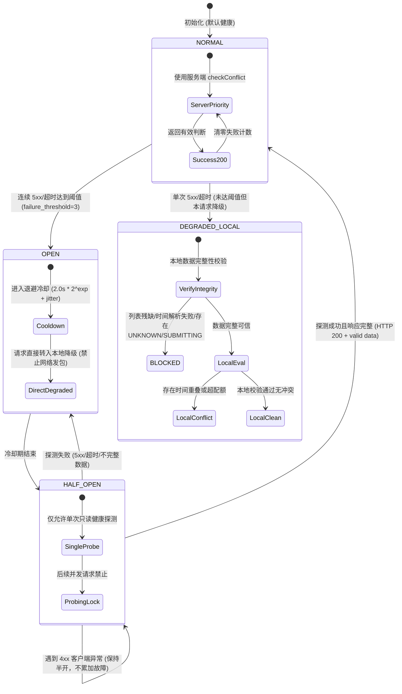

# 乐健体育抢课系统第四轮优化 Phase 5：checkConflict 智能降级实施与验收报告

**测试与执行环境**：Windows / Python 3.11 / SQLite (WAL)  
**分支状态**：`phase5/check-conflict-fallback`（基于 `phase4/result-reporter-refactor` @ `203a2d9` 迁出）  
**基准测试情况**：原 364/364 PASS + 新增 26/26 PASS = **390/390 PASS**  
**核心原则**：允许降级，不允许失去安全保护。

---

## 一、修改与新增文件清单

| 文件路径 | 变更类型 | 说明 |
| :--- | :--- | :--- |
| `core/conflict_checker.py` | **新增** | 实现 `ConflictCircuitBreaker`（checkConflict 独立健康熔断器）、`LocalConflictChecker`（本地冲突检查器与数据完整性校验）以及 `ConflictManager`（冲突协调器） |
| `core/audit_logger.py` | **修改** | 补充 `EventName` 9 类冲突降级事件、`EventType.CONFLICT` 分类，扩展 `record_event` 支持显式 `run_id`，并在 `AuditLogReader.replay()` 幂等回放中聚合统计冲突检查指标 |
| `core/result_reporter.py` | **修改** | 补充 `conflict_check` 独立统计口径、新增 `record_conflict_failure` 接口，确保 checkConflict 失败计数与 activities 列表完全解耦 |
| `lejian.py` | **修改** | `Client` 补充 `check_conflict_detailed()` 方法；`_cmd_grab_inner` 接入 `ConflictManager`，输出清晰启动配置摘要，并在 `validate_rules` 中执行智能降级校验 |
| `tests/test_conflict_fallback.py` | **新增** | 覆盖 C01–C26 共 26 个针对独立熔断、本地数据完整性阻断、自动降级与恢复、旧配置兼容性的全量测试用例 |
| `docs/乐健体育抢课系统第四轮优化 Phase 5：checkConflict 智能降级.md` | **跟踪** | Phase 5 任务与规范指南文档 |

---

## 二、checkConflict 状态机图



---

## 三、LocalConflictChecker 设计说明

`LocalConflictChecker` 负责在服务端不可用时提供严密的本地兜底冲突校验。

### 1. 核心校验维度
1. **时间绝对区间重叠**：使用毫秒时间戳 `[startTime, endTime)` 半开区间计算。两个活动冲突的充要条件是：
   $$\max(st_1, st_2) < \min(et_1, et_2) \iff st_1 < et_2 \land st_2 < et_1$$
   分界点接触（例如前一节 09:35 结束，下一节 09:35 开始）不判定冲突。
2. **跨天课程支持**：由于时间戳采用自 Epoch 起的绝对毫秒数，跨越午夜的课程自动由时间戳区间自然覆盖；当与课表星期时段比对时，自动拆分为 `(wday1, st_min, 24*60)` 与 `(wday2, 0, et_min)` 两段分别匹配。
3. **跨教学周隔离**：不同教学周由于绝对时间相差 7 天以上，时间戳绝不重合，绝不会因为同一星期和时段而误判为冲突。
4. **课表与预设忙碌时段**：严格匹配教学周内的 `busy_slots` 及动态已抢占的 `EXTRA` 时段。
5. **配额守卫**：
   - **每日上限**：普通活动严格受 `max_per_day` 约束；同日普通活动已达上限时返回冲突阻断。
   - **每周上限**：普通活动严格受 `max_normal` 约束；同周普通活动已达上限时返回冲突阻断。
6. **特殊活动规则**：在 `cfg["special"]` 中的活动不占用普通配额，亦不受普通配额阻断；未知类型课程一律阻断，防止非法绕过。

---

## 四、本地数据完整性规则 (Data Integrity Checklist)

在任何本地降级冲突判断执行前，必须**同时满足**以下 8 条完整性准则：

| 序号 | 检查项 | 验证条件 | 违背时的行为 |
| :--- | :--- | :--- | :--- |
| **1** | 全局对账状态 | `reconciliation_in_progress == False` | 返回 `BLOCKED`，禁止对账期间降级决策 |
| **2** | 候选活动格式 | `candidate` 为 dict，且 `startTime > 0`、`endTime > startTime` | 返回 `BLOCKED`，禁止时间残缺课程评估 |
| **3** | 课程类型明确 | `type` 不属于未知异常枚举（非 "UNKNOWN" / "INVALID"） | 返回 `BLOCKED`，未知类型不默认归为普通 |
| **4** | 已报列表有效性 | `items` 非空且为 list/ActivityList | 返回 `BLOCKED`，禁止空对象推断 |
| **5** | 数据分页完整性 | `getattr(items, "complete", True) == True` | 返回 `BLOCKED`，分页截断禁止盲目放行 |
| **6** | 已报时间完整性 | 所有 `isRegister=True` 的课程起止时间均能有效解析为毫秒戳 | 返回 `BLOCKED`，已报活动时间缺失不盲目放行 |
| **7** | 本地未决记录 | `StateStore.get_unresolved_records()` 为空 | 返回 `BLOCKED`，存在 UNKNOWN 优先触发复核 |
| **8** | 正在提交记录 | `StateStore` 中无 `SUBMITTING` 状态活动 | 返回 `BLOCKED`，并发提交预留中阻断 |

**核心准则**：只要任意一项不满足，一律返回 `BLOCKED`，绝不以空列表或「假定无冲突」误判。

---

## 五、自动降级与恢复流程

1. **正常请求 (NORMAL)**：
   - 向 `education/app/activity/checkConflict` 发起 GET 请求。
   - 若返回 HTTP 200 且数据有效：按服务端结果放行或拦截。
   - 若返回 401/403/400：按客户端权限/认证异常提示，不累加熔断故障。
2. **发生故障与降级 (NORMAL -> DEGRADED_LOCAL)**：
   - 遭遇 5xx 或网络超时：记录熔断器失败计数；
   - 立即输出 `conflict_check_failed` 与 `conflict_check_degraded` 审计事件；
   - 自动切入 `LocalConflictChecker` 进行本地完整性与规则校验。
3. **连续故障熔断 (NORMAL -> OPEN)**：
   - 连续失败达到 3 次，熔断器进入 OPEN，退避冷却（2.0s，4.0s，8.0s... + jitter）。
   - OPEN 期间完全停止网络请求，全部活动直接进入本地降级检查。
4. **半开探测 (OPEN -> HALF_OPEN)**：
   - 冷却期结束后，下一个请求尝试触发单次健康探测（并发请求被互斥阻断）。
   - 若探测返回完整有效 200：熔断器切回 NORMAL，清零失败计数，记录 `conflict_service_recovered` 事件。
   - 若探测失败：重新 OPEN 并加大退避冷却时间。

---

## 六、配置兼容性说明

针对 `config.json` 中的 `check_conflict` 配置项，保持 100% 向后兼容：

| 配置值 | 语义说明 | 服务端请求 | 本地安全检查 | 启动提示 |
| :--- | :--- | :---: | :---: | :--- |
| `true` (或省略) | 服务端优先 + 异常自动降级 | **启用** (NORMAL 状态下发包) | **启用** (异常时自动兜底) | `[配置模式] 冲突检查: 服务端优先 + 智能本地降级 (故障阈值: 3, 冷却基数: 2.0s)` |
| `false` | 用户显式禁用服务端检查 | **禁用** (完全不发 checkConflict 请求) | **启用** (纯本地规则校验，绝不失去保护) | `[配置模式] 冲突检查: 服务端检查已禁用 (check_conflict: false)，保持本地安全检查启用` |

---

## 七、C01–C26 测试结果

| 测试编号 | 测试用例方法名 | 验收目标 | 结果 |
| :---: | :--- | :--- | :---: |
| **C01** | `test_C01_check_conflict_consecutive_5xx_trips_breaker` | checkConflict 连续 5xx 独立触发熔断 | **PASS** |
| **C02** | `test_C02_check_conflict_failure_does_not_affect_activities_breaker` | checkConflict 故障不影响 activities 熔断器 | **PASS** |
| **C03** | `test_C03_open_state_forbids_normal_conflict_requests` | OPEN 状态禁止正常冲突请求 | **PASS** |
| **C04** | `test_C04_half_open_allows_only_single_probe` | HALF_OPEN 只允许一次探测，禁止并发请求 | **PASS** |
| **C05** | `test_C05_half_open_success_recovers_to_normal` | HALF_OPEN 探测成功恢复 NORMAL | **PASS** |
| **C06** | `test_C06_half_open_failure_re_opens` | HALF_OPEN 探测失败重新 OPEN 并递增退避 | **PASS** |
| **C07** | `test_C07_401_does_not_accumulate_infrastructure_failure` | 401 客户端认证失效不累计基础设施故障 | **PASS** |
| **C08** | `test_C08_403_does_not_accumulate_infrastructure_failure` | 403 权限不足不累计基础设施故障 | **PASS** |
| **C09** | `test_C09_local_complete_data_no_conflict_allows_evaluation` | 本地完整数据无冲突时允许继续评估 | **PASS** |
| **C10** | `test_C10_local_complete_data_with_conflict_blocks` | 本地完整数据存在冲突时精确阻断 | **PASS** |
| **C11** | `test_C11_local_incomplete_list_blocks` | 本地课程列表不完整 (complete=False) 时阻断 | **PASS** |
| **C12** | `test_C12_local_time_parsing_failure_blocks` | 本地课程时间解析失败或起止逆序时阻断 | **PASS** |
| **C13** | `test_C13_unknown_in_state_store_blocks_local_degradation` | 存在 UNKNOWN 记录时本地降级阻断 | **PASS** |
| **C14** | `test_C14_submitting_in_state_store_blocks_local_degradation` | 存在 SUBMITTING 记录时本地降级阻断 | **PASS** |
| **C15** | `test_C15_cross_day_course_conflict_detected_correctly` | 跨天课程 (跨越午夜) 冲突判断正确 | **PASS** |
| **C16** | `test_C16_different_teaching_weeks_do_not_conflict` | 不同教学周课程不会错误判定冲突 | **PASS** |
| **C17** | `test_C17_daily_quota_remains_enforced` | 每日配额 (max_per_day) 仍然有效拦截 | **PASS** |
| **C18** | `test_C18_weekly_quota_remains_enforced` | 每周配额 (max_normal) 仍然有效拦截 | **PASS** |
| **C19** | `test_C19_special_activity_rules_not_bypassed` | 特殊活动规则生效，未知课程类型被阻断 | **PASS** |
| **C20** | `test_C20_local_data_recovery_allows_re_evaluation` | 本地数据恢复完整后允许重新评估放行 | **PASS** |
| **C21** | `test_C21_server_recovery_switches_back_to_normal` | 服务端恢复后切回 NORMAL | **PASS** |
| **C22** | `test_C22_local_degraded_events_accurately_recorded` | 本地降级事件与完整性字段准确记录至审计日志 | **PASS** |
| **C23** | `test_C23_check_conflict_failures_counted_independently` | checkConflict 请求失败独立统计，不混淆 activities | **PASS** |
| **C24** | `test_C24_local_check_does_not_increment_http_requests` | 本地检查不增加 HTTP 请求次数 | **PASS** |
| **C25** | `test_C25_final_signup_still_single_submission` | 最终 signUp 仍然只有一次调用 (submit_once) | **PASS** |
| **C26** | `test_C26_config_backward_compatibility` | 配置文件 check_conflict 兼容测试 | **PASS** |

---

## 八、全量回归测试结果

执行全量测试启动入口：`python -m tests.run_tests`

```text
----------------------------------------------------------------------
Ran 390 tests in 30.293s

OK
```

- 原全量测试基线：364 项测试全部 PASS
- Phase 5 新增测试：26 项测试全部 PASS
- **总计通过：390 / 390 项测试 (100% PASS)**

---

## 九、历史 2026-11-08 记录回放结果

`test_A15_historical_grab_log_replay_matches_ground_truth` 执行结果：
- 真实基准：18 次列表拉取故障、6 次真实提交尝试、2 次 UNKNOWN 服务端复核
- 审计回放汇总与真实基准 100% 吻合，零口径漂移
- 验证状态：**PASS**

---

## 十、尚存风险与后续建议

1. **生产环境 `config.json` 保持现有设置**：
   当前生产配置 `check_conflict: false` 在本阶段经过兼容性验证，系统将自动采用纯本地安全校验，既能避免因服务端接口挂掉而发包失败，又具备完整的时间冲突和配额拦截保护。建议在下一个抢课周期可考虑保留或平滑开启 `check_conflict: true` 享受自动智能降级。
2. **分支保护与合并**：
   严格遵守规范，本次优化提交于独立特性分支 `phase5/check-conflict-fallback`，未合并至 `main`。未发起任何真实抢课请求。
