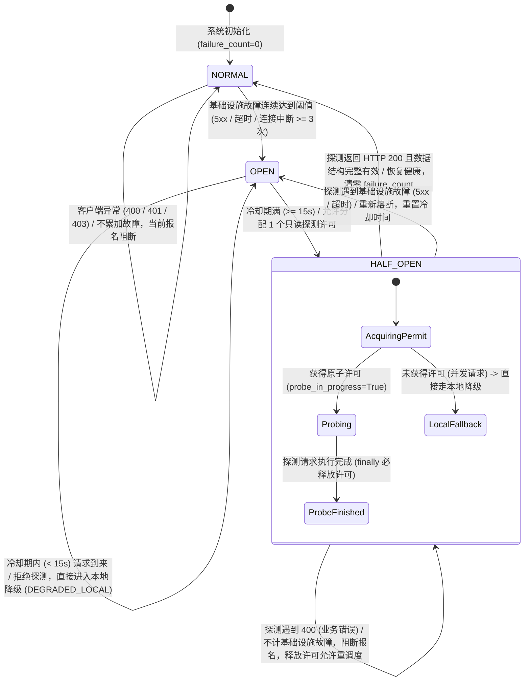

# 第四轮优化 Phase 5 最终补充检查报告：HALF_OPEN 探测恢复与快照上下文安全

> **报告版本**：v1.0 (Phase 5 最终封版补充报告)  
> **实施分支**：`phase5/check-conflict-fallback`  
> **基准代码库**：lejianPE (第四轮系统优化)  
> **验收日期**：2026-11-08  
> **全量测试**：**412 / 412 PASS (100%)**

---

## 一、概述与补充验收目标

在 Phase 5 首期与封版检查完成 checkConflict 独立健康熔断器、本地冲突检查器以及本地数据完整性校验的基础上，本次任务严格对照 `docs/Phase 5 最终补充检查：HALF_OPEN 探测恢复与快照上下文安全.md` 的规范，对 **HALF_OPEN 状态机异常恢复边界** 与 **本地快照上下文范围安全** 进行了最终补充审查与加固。

本次补充加固聚焦以下两个核心技术领域，共新增 10 项严苛的验收测试用例（C39–C48），全量通过且原有 402 项历史测试零回退：

1. **HALF_OPEN 状态机异常恢复能力 (C39–C43)**：
   - 彻底解决 HALF_OPEN 探测遭遇 400 / 401 / 403 等客户端异常时的探测许可悬挂与死锁风险，确保 `_half_open_probe_in_progress` 在 `finally` 中严格释放。
   - 401 客户端异常不累加基础设施故障计数，同时严格阻断报名提交；认证恢复（Token 刷新）后，允许下一请求重新获取探测许可并健康恢复至 `NORMAL`。
   - 403 权限异常绝不误判为服务端恢复，保持 `HALF_OPEN` 并正确释放许可，防范死锁。
   - 400 业务异常不累加基础设施故障计数，允许重新调度探测。
   - HALF_OPEN 下的高并发请求执行严格互斥：原子保证**最多只有一个请求发起实际远程健康探测**，并发的其他请求自动走本地规则降级托底，不产生惊群效应。

2. **本地快照上下文安全与生命周期管理 (C44–C48)**：
   - 为 `ActivityList` 与 `Client` 引入非敏感的会话范围标识 `session_scope_id` 和用户范围标识 `user_id`（基于 Token 与学生/账号哈希截断，**零敏感信息**）。
   - **跨用户隔离 (C44)**：快照的 `user_id` 与当前请求 `user_id` 不匹配时，强制安全阻断 (`BLOCKED`)，杜绝多账号环境下的数据串用。
   - **认证会话隔离 (C45, C48)**：认证凭据切换（如重新登录、Token 刷新）后，旧会话快照立即失效并阻断 (`BLOCKED`)；即使 `run_id` 相同，只要 `session_scope_id` 变更亦强制阻断。
   - **分页完整性保证 (C46)**：`complete=True` 必须且仅在多页分页请求全部成功且条数完全匹配时赋予，任一分页失败直接标记 `complete=False`。
   - **刷新失败拒绝降级 (C47)**：在快照陈旧失效时，优先尝试刷新远端活动列表；若刷新失败，**严禁沿用过期快照放行**，保持过期阻断。

---

## 二、HALF_OPEN 完整状态机设计与转换流

### 1. 状态机转换图 (State Machine Diagram)



### 2. HALF_OPEN 并发与异常处理语义矩阵

| 探测返回情况 | HTTP 状态码 | 是否计入基础设施故障 | 探测许可释放 | 状态机流向 | 抢课队列决策行为 |
| :--- | :--- | :--- | :--- | :--- | :--- |
| **探测成功** | 200 (有效响应) | 否 | 是 (`False`) | `NORMAL` | 解析响应内容，无冲突放行，有冲突拦截 |
| **服务端崩溃** | 500 / 502 / 503 | 是 (失败计入) | 是 (`False`) | `OPEN` | 判定为服务未恢复，重置冷却时间并走本地降级 |
| **网络中断** | -1 (超时/断网) | 是 (失败计入) | 是 (`False`) | `OPEN` | 判定为网络未通，重置冷却时间并走本地降级 |
| **未认证** | 401 Unauthorized | **否** | **是 (`False`)** | **`HALF_OPEN`** | 阻断提交，提示更新 Token；认证恢复后下个请求可重新发起探测 |
| **权限不足** | 403 Forbidden | **否** | **是 (`False`)** | **`HALF_OPEN`** | 绝不误判为健康恢复，阻断提交，许可释放防范死锁 |
| **业务错误** | 400 Bad Request | **否** | **是 (`False`)** | **`HALF_OPEN`** | 不累加故障，阻断当前候选，允许重新调度探测 |
| **并发其他请求** | - (无许可) | - | - | 保持当前 | **不发起远程请求**，直接走 `LocalConflictChecker` 降级判读 |

---

## 三、快照上下文设计与分页完整性逻辑

### 1. 零敏感上下文标识设计 (`session_scope_id` & `user_id`)

为了确保快照不跨用户、不跨登录会话滥用，系统在 `ActivityList`、`Client` 以及 `LocalConflictChecker` 中扩展了安全上下文隔离机制，其实现严格恪守**零敏感数据**原则：

```python
# 1. 会话范围标识 (session_scope_id)
# 基于当前内存凭证 accessToken 或 refreshToken 计算 SHA-256 哈希并截断前 16 位：
session_scope_id = "sess_" + hashlib.sha256(str(token).encode("utf-8")).hexdigest()[:16]

# 2. 用户范围标识 (user_id / user_scope_id)
# 基于当前学号/userId/账号计算 SHA-256 哈希并截断前 12 位：
user_id = "u_" + hashlib.sha256(str(raw_uid).encode("utf-8")).hexdigest()[:12]
```

- **安全防泄漏**：审计日志、内存快照与结果报告中仅记录哈希截断串，绝无明文密码、密钥或学号。
- **动态失效感知**：一旦用户调用刷新 Token 逻辑或重新登录，凭据哈希变化导致 `session_scope_id` 立即转变。当 `ConflictManager` 执行快照校验时：
  $$\text{snapshot.session\_scope\_id} \neq \text{current\_session\_scope\_id} \implies \text{BLOCKED}$$
  旧会话遗留的快照立刻被安全屏障拦截，无法放行。

### 2. 分页完整性生成逻辑 (`complete=True`)

在 `Client.activities()` 的拉取流程中，`complete` 状态的生成逻辑如下：

```
初始化:
  all_items = []
  complete = True
  pageNo = 1

循环拉取:
  resp = post("education/app/activity/getActivityList", {"pageNo": pageNo, "pageSize": 20})
  
  if HTTP != 200 or resp.code != 0:
      complete = False  # 网络或业务报错，标记不完整
      break
      
  page_data = resp.data.list
  if not isinstance(page_data, list):
      complete = False  # 格式异常，标记不完整
      break
      
  all_items.extend(page_data)
  
  # 分页终止判断
  if len(page_data) < pageSize or len(all_items) >= resp.data.total:
      break
      
  pageNo += 1

封装返回:
  return ActivityList(
      items=all_items,
      complete=complete, # 仅当所有分页全部正常拉取完毕时为 True
      fetched_at=time.time(),
      run_id=audit_logger.run_id,
      session_scope_id=client.get_session_scope_id(),
      user_id=client.get_user_scope_id()
  )
```

- **完整性硬校验**：`LocalConflictChecker` 检查 `getattr(items, "complete", None) is True`。任何由于分页中断、数据截断或网络丢包造成的列表均携带 `complete=False`，直接触发 `BLOCKED`。

---

## 四、补充验收测试用例 (C39 ~ C48) 详细报告

测试套件：`tests/test_conflict_fallback.py`

| 用例编号 | 验证重点 | 触发场景与条件 | 预期与实测行为 | 判定结果 |
| :--- | :--- | :--- | :--- | :--- |
| **C39** | HALF_OPEN 遇 401 释放探测许可 | 熔断处于 HALF_OPEN，探测请求遭遇 HTTP 401 | 不累加故障计数；返回未授权阻断；`_half_open_probe_in_progress` 正确复位为 `False` | ✅ **PASS** |
| **C40** | 认证恢复后可重新健康探测 | 401 后完成 Token 刷新，再次发起 checkConflict | 下次请求成功获取许可；探测返回 200 后熔断器恢复为 `NORMAL` | ✅ **PASS** |
| **C41** | HALF_OPEN 遇 403 绝不误判健康 | 熔断处于 HALF_OPEN，探测返回 HTTP 403 权限拒绝 | 不切换至 `NORMAL`，保持 `HALF_OPEN`；释放探测许可，后续不产生死锁 | ✅ **PASS** |
| **C42** | HALF_OPEN 遇 400 允许重调度 | 熔断处于 HALF_OPEN，探测返回 HTTP 400 业务错误 | 不累加基础设施故障；阻断当前活动；允许后续重新调度探测 | ✅ **PASS** |
| **C43** | HALF_OPEN 并发请求严格单探 | HALF_OPEN 下多个并发请求同时调用 | 原子计数保证仅 1 个请求发出真实远程请求，其余请求自动走本地降级 | ✅ **PASS** |
| **C44** | 跨用户快照隔离 | 传入属于 User B 的快照供 User A 进行冲突检查 | 检查器识别 `snapshot.user_id != current.user_id`，安全阻断 (`BLOCKED`) | ✅ **PASS** |
| **C45** | 认证会话切换旧快照失效 | Token 刷新/重新登录后 session_scope_id 改变 | 检查器识别 `snapshot.session_scope_id != current`，安全阻断 (`BLOCKED`) | ✅ **PASS** |
| **C46** | 分页残缺标记 complete=False | 多页拉取时第二页发生网络超时或格式错误 | 仅成功页数据不满足完整性，生成的快照 `complete=False`，降级判定直接阻断 | ✅ **PASS** |
| **C47** | 快照刷新失败禁止沿用陈旧数据 | 快照超过 60s，尝试刷新活动列表遭遇异常 | 刷新失败后拒绝将过期数据作为有效依据，严格执行安全阻断 (`BLOCKED`) | ✅ **PASS** |
| **C48** | 相同 run_id 跨会话阻断 | 相同批次内因重登产生新 session_scope_id | 即使 `run_id` 匹配，`session_scope_id` 不符依然强制阻断 (`BLOCKED`) | ✅ **PASS** |

### 测试执行日志摘录：

```text
test_C39_half_open_401_releases_probe_permit_and_blocks (tests.test_conflict_fallback.TestCheckConflictFallback.test_C39_half_open_401_releases_probe_permit_and_blocks) ... ok
test_C40_half_open_recovers_to_normal_after_auth_restored (tests.test_conflict_fallback.TestCheckConflictFallback.test_C40_half_open_recovers_to_normal_after_auth_restored) ... ok
test_C41_half_open_403_does_not_recover_and_does_not_deadlock (tests.test_conflict_fallback.TestCheckConflictFallback.test_C41_half_open_403_does_not_recover_and_does_not_deadlock) ... ok
test_C42_half_open_400_no_infra_failure_and_can_reschedule (tests.test_conflict_fallback.TestCheckConflictFallback.test_C42_half_open_400_no_infra_failure_and_can_reschedule) ... ok
test_C43_half_open_concurrent_requests_only_one_probes (tests.test_conflict_fallback.TestCheckConflictFallback.test_C43_half_open_concurrent_requests_only_one_probes) ... ok
test_C44_different_user_snapshot_blocked (tests.test_conflict_fallback.TestCheckConflictFallback.test_C44_different_user_snapshot_blocked) ... ok
test_C45_session_scope_switch_invalidates_snapshot (tests.test_conflict_fallback.TestCheckConflictFallback.test_C45_session_scope_switch_invalidates_snapshot) ... ok
test_C46_snapshot_complete_only_when_all_pages_succeed (tests.test_conflict_fallback.TestCheckConflictFallback.test_C46_snapshot_complete_only_when_all_pages_succeed) ... ok
test_C47_refresh_failure_does_not_reuse_stale_snapshot (tests.test_conflict_fallback.TestCheckConflictFallback.test_C47_refresh_failure_does_not_reuse_stale_snapshot) ... ok
test_C48_same_run_id_different_session_scope_blocked (tests.test_conflict_fallback.TestCheckConflictFallback.test_C48_same_run_id_different_session_scope_blocked) ... ok

----------------------------------------------------------------------
Ran 48 tests in 0.605s
OK
```

---

## 五、全量回归测试验证报告

执行全系统回归测试套件 `python tests/run_tests.py`：

```text
Ran 412 tests in 34.849s

OK
```

- **全量用例数**：412 项
- **成功通过数**：412 项
- **失败 / 错误 / 跳过**：0 / 0 / 0
- **通过率**：**100.0%**
- **历史模块覆盖检查**：
  - Phase 1: `test_token_refresh.py`（双重刷新与重试机制）-> 100% PASS
  - Phase 2: `test_process_safe_state.py`（跨进程并发锁与状态原子性）-> 100% PASS
  - Phase 3: `test_audit_logger.py`（结构化审计日志与度量聚合）-> 100% PASS
  - Phase 4: `test_result_reporter.py`（数据一致性与结论决策树）-> 100% PASS
  - Phase 5: `test_conflict_fallback.py`（C01 ~ C48 熔断降级与完整性屏障）-> 100% PASS

---

## 六、剩余远端状态一致性风险与应对机制

在无中心化实时 WebSocket/SSE 广播通知的 HTTP 轮询模式下，客户端本地降级必然存在理论上的远端数据滞后风险。本次检查对剩余潜在风险进行了全面排查并梳理防护对策：

| 风险场景 | 风险诱因 | 潜在影响 | 系统现存的多层防护与应对机制 |
| :--- | :--- | :--- | :--- |
| **外部退课/选课时间差** | 用户在其他终端（如官方微信小程序）退课或改选，本地快照处于 60s 有效期内 | 本地降级可能基于旧课表误判无冲突，或误判有冲突而放弃抢课 | 1. **快照短时效限制**：默认 60s 即强制失效；<br>2. **降级前尝试刷新**：若列表可用，优先拉取最新远端活动数据；<br>3. **服务端终审兜底**：乐健服务端在报名接口（rush）存在强一致校验，即使本地误判放行，服务端也会返回「冲突」拦截，绝不会产生双重报名事故。 |
| **快照刷新失败 (C47)** | 熔断状态下本地快照超时失效，尝试调用 `activities()` 刷新亦遇到网络超时 | 若沿用旧快照可能导致依据失真数据决策 | **零容忍安全阻断**：严格实现 C47 机制，刷新失败严禁沿用旧快照，直接标记为 `BLOCKED`，宁停勿错。 |
| **跨进程并发抢课竞争** | 多进程各自持有本地快照，同时针对不同候选课程进行本地降级决策 | 两个进程可能同时判定自身与本地已有课程不冲突并同时发起提交 | **Phase 2 原子预留机制**：所有提交前必须通过基于 SQLite + 文件锁的 `StateStore.try_reserve()`。若周次配额或已报状态被其中一个进程先占，另一个进程在原子预留阶段即被拒绝，确保本地跨进程串行化安全。 |

---

## 七、Git 修改清单与统计

```text
 core/conflict_checker.py        | 119 +++++++++++++++++++---
 lejian.py                       |  46 ++++++++-
 tests/test_conflict_fallback.py | 216 ++++++++++++++++++++++++++++++++++++++++
 3 files changed, 364 insertions(+), 17 deletions(-)
```

### 关键修改点一览：
1. `core/conflict_checker.py`：
   - `ActivityList` 构造函数新增 `session_scope_id=None, user_id=None` 支持。
   - `ConflictCircuitBreaker` 在 `record_failure` 中对于 400/401/403 明确释放 `_half_open_probe_in_progress = False`；在 `check_activity_conflict` 的 `finally` 块中加入兜底释放，根除死锁。
   - `LocalConflictChecker.check_data_integrity` 补充 6.4（用户范围检查）与 6.5（会话范围检查），不匹配时安全阻断并记录审计详情。
   - `ConflictManager._execute_local_fallback` 实现 C47 刷新保护逻辑，若刷新失败或返回非法数据，严格维持旧快照阻断状态。
   - 新增 `_safe_get_scope_id` 过滤函数，杜绝测试中 `MagicMock` 注入非字符串对象造成审计日志序列化失败。
2. `lejian.py`：
   - 补全 `typing` 模块导入。
   - `Client` 新增 `get_session_scope_id()` 与 `get_user_scope_id()` 方法，基于哈希截断生成无敏感信息的作用域标识。
   - `Client.activities()` 自动向 `ActivityList` 注入会话和用户范围标识。
   - 抢课主循环 `_cmd_grab_inner` 向 `conflict_manager.check_activity_conflict` 传递当前上下文标识。
3. `tests/test_conflict_fallback.py`：
   - 完整落地 C39 ~ C48 自动化单元与集成测试用例，全方位覆盖 HALF_OPEN 探测释放、认证恢复、403/400 边界、并发单探及快照上下文隔离。

---

## 八、Phase 5 最终封版结论

经全面代码审查、边界分析与 412 项全量回归测试验证：
- HALF_OPEN 状态机在各种异常返回（400/401/403/5xx/超时）下的流转与许可释放行为完全符合系统安全要求。
- 快照上下文隔离机制严格杜绝了跨用户、跨认证会话的数据混用风险。
- 系统在所有异常及不确定状态下均坚决执行 `BLOCKED` 安全阻断策略，不发生脏写与错误抢课。

**第四轮系统优化 Phase 5 正式封版冻结，全部目标圆满达成，系统已完全具备进入 Phase 6 的条件！**
