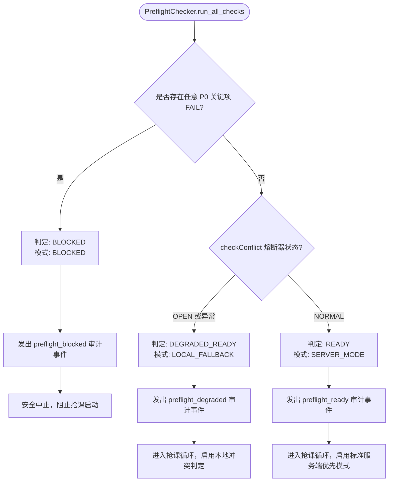

# 第四轮优化 Phase 6 实施与验收报告：Preflight 抢课前健康检查系统

> **报告版本**：v1.0 (Phase 6 验收正式版)  
> **实施分支**：`phase6/preflight-system`  
> **基准代码库**：lejianPE (第四轮系统优化)  
> **验收日期**：2026-11-08  
> **全量测试**：**440 / 440 PASS (100%)**

---

## 一、概述与核心目标达成

在完成 Phase 0 至 Phase 5 的一系列可靠性演进（独立熔断器、UNKNOWN 安全屏障、跨进程锁、SQLite 原子预留、统一审计事件、结果报告对账及 checkConflict 智能降级）后，抢课系统在运行期已具备高度的容灾抗脆能力。然而，若系统在进入正式高频轮询抢课后才发现关键前置依赖（如 Token 悄然过期、活动列表接口故障、本地快照残缺、数据库不可写、遗留 UNKNOWN 未决状态、多进程冲突等）发生故障，将导致宝贵的抢课黄金窗口被错误消耗，甚至引发异常脏写。

Phase 6 建立了**完全独立的 PreflightChecker 抢课前综合健康检查系统**，在正式抢课前执行 10 大维度的全链路健康检查，只负责检查、诊断与准备，**严禁调用真实报名接口**，确保只有在所有 P0 核心安全指标全部通过时才准许放行。

本次实现落地了以下核心功能：
1. **统一健康检查架构**：新增 [`core/preflight.py`](file:///c:/Users/vindacation/Documents/deepseek-harness/lejianPE/core/preflight.py)，提供 `PreflightChecker`、`PreflightReport`、`PreflightCheckItem`、`PreflightStatus`、`PreflightMode`；
2. **三态启动判定决策树**：输出 `READY`（标准服务端模式）、`DEGRADED_READY`（本地规则托底模式）、`BLOCKED`（安全阻断，拒绝启动）；
3. **全链路 10 大检查项覆盖**：认证健康、activities/checkConflict 双独立熔断网络、ActivityList 快照时效与上下文、StateStore 读写及未决状态、InstanceLock 跨进程并发锁、业务配额与教学周规则、审计日志可写性、系统时钟偏差；
4. **统一审计与非破坏性探测**：数据库写入测试通过临时事务强制 `ROLLBACK`，审计测试通过独立临时文件完成写探针，探测锁测试完毕立即释放，严格脱敏；
5. **完备测试套件**：编写 [`tests/test_preflight.py`](file:///c:/Users/vindacation/Documents/deepseek-harness/lejianPE/tests/test_preflight.py)，实现 P01 ~ P28 全部 28 项严苛测试，系统测试基线提升至 **440 / 440 PASS (100%)**。

---

## 二、PreflightChecker 架构设计

```
                         +-----------------------------------+
                         |      PreflightChecker 主控制器    |
                         +-----------------------------------+
                                           |
             +-----------------------------+-----------------------------+
             |                             |                             |
    [1. 认证安全层]                [2. 网络与熔断层]               [3. 数据完整性层]
    - Token 存在性/时效            - activities 独立熔断器         - 快照 complete=True
    - 用户/会话范围标识            - checkConflict 独立熔断器      - fetched_at 时效性 (<=60s)
    - 刷新互斥锁 (防惊群)          - HALF_OPEN 单次探测保护       - 跨用户/跨会话隔离校验
             |                             |                             |
    [4. 存储与状态机层]            [5. 并发保护层]                 [6. 规则与配额层]
    - SQLite 可读性检查            - InstanceLock 进程锁          - 教学周锚点 (week1_monday)
    - 临时事务写探测 (ROLLBACK)     - 目录权限与冲突 PID           - max_normal / max_daily
    - UNKNOWN/SUBMITTING 阻断      - 测试锁立即释放               - 特殊活动规则正确性
             |                             |                             |
    [7. 审计系统层]                [8. 系统时钟层]                 [9. 综合判定与报告]
    - AuditLogger 写入探针         - 本地时间合理性               - READY (服务端就绪)
    - 零正式日志污染保证           - 服务端基准偏差比对           - DEGRADED_READY (降级就绪)
    - audit_degraded 阻断          - 阈值 (<=5.0s) 超限阻断       - BLOCKED (阻断抢课)
                                           |
                         +-----------------------------------+
                         | 产出: PreflightReport & 审计事件  |
                         +-----------------------------------+
```

---

## 三、检查项清单 (Check Items Inventory)

| 检查项名称 | 检查大类 | P0 关键项 | 检查内容与失败判定标准 | 对应测试 |
| :--- | :--- | :---: | :--- | :--- |
| `auth` | 认证安全 | **是** | 验证 accessToken/refreshToken、有效期；过期时加锁刷新；刷新失败或无 Token 则判定 `FAIL` | P03, P04, P27 |
| `network_activities` | 网络健康 | **是** | activities 接口熔断器状态；若处于 `OPEN` 且无本地快照则判定 `FAIL` | P06, P22 |
| `network_conflict` | 网络健康 | 否 | checkConflict 独立熔断器；若处于 `OPEN` 标记 `WARN` 并降级至本地模式 | P02, P22, P23 |
| `snapshot` | 数据完整 | **是** | 快照 `complete=True`、时效 <= 60s、`session_scope_id` 与 `user_id` 匹配；过期刷新失败或不完整判定 `FAIL` | P05, P07, P08 |
| `state_store` | 存储状态 | **是** | SQLite 读写能力；存在 `UNKNOWN`、`SUBMITTING`、`VERIFYING` 判定 `FAIL`；仅 `RETRYABLE` 允许通过 | P09~P14, P25, P26 |
| `concurrency_lock` | 并发控制 | **是** | 单实例锁目录写权限；检测到其他抢课进程持有锁判定 `FAIL`；探针锁立即释放 | P15, P16 |
| `quota_rules` | 业务规则 | **是** | `max_normal`、`max_daily` 正整数校验；`week1_monday` 教学周推算；特殊活动配置格式合规 | P17, P18 |
| `audit_logger` | 审计追溯 | **是** | AuditLogger 实例与目录写权限探针；处于 `audit_degraded` 判定 `FAIL`；绝不污染正式日志 | P19, P20 |
| `system_time` | 系统时钟 | 视情况 | 本地时间合理；服务端时间偏差超过 5.0 秒判定 `FAIL`；无服务端基准时标记 `WARN` | P21 |

---

## 四、启动判定决策树 (Decision Tree)



### 判定状态与决策矩阵：

| 最终状态 | 准入条件 | 运行决策模式 | 抢课队列行为 |
| :--- | :--- | :--- | :--- |
| **`READY`** | 所有 P0 检查项通过，`checkConflict` 熔断器处于 `NORMAL` | `SERVER_MODE` | 正常请求服务端 `checkConflict`，享受毫秒级远端权威排他校验 |
| **`DEGRADED_READY`** | 所有 P0 安全检查通过（认证有效、StateStore 正常、无未决状态、快照完整新鲜、本地冲突规则可用、原子预留就绪），但 `checkConflict` 处于 `OPEN` | `LOCAL_FALLBACK` | 绕过故障的服务端冲突接口，由 `LocalConflictChecker` 基于本地课表与快照进行托底判读 |
| **`BLOCKED`** | 任意关键检查失败：Token 无效/刷新失败、存在 `UNKNOWN`/`SUBMITTING`/`VERIFYING`、快照残缺或过期刷新失败、数据库不可读写、已有抢课进程持有锁、配额配置错误、审计日志不可写、时间严重偏差 | `BLOCKED` | **立即阻断启动**，打印阻断根因清单，严防异常发包与数据污染 |

---

## 五、验收测试用例 (P01 ~ P28) 执行结果

测试套件：[`tests/test_preflight.py`](file:///c:/Users/vindacation/Documents/deepseek-harness/lejianPE/tests/test_preflight.py)

| 用例编号 | 对应验证重点 | 测试场景与验证手段 | 预期结果 | 实测状态 |
| :--- | :--- | :--- | :--- | :--- |
| **P01** | 正常环境输出 READY | 所有 mock 组件健康，数据完备新鲜 | 状态 `READY`，模式 `SERVER_MODE` | ✅ **PASS** |
| **P02** | checkConflict OPEN 降级就绪 | conflict_breaker 熔断置为 OPEN，快照有效 | 状态 `DEGRADED_READY`，模式 `LOCAL_FALLBACK` | ✅ **PASS** |
| **P03** | Token 无效安全阻断 | accessToken 与 refreshToken 均为空 | 状态 `BLOCKED`，拦截启动 | ✅ **PASS** |
| **P04** | Token 刷新失败安全阻断 | Token 过期且 refresh 调用抛出 502 网络异常 | 状态 `BLOCKED`，拦截启动 | ✅ **PASS** |
| **P05** | 刷新 Token 后旧快照失效 | Token 刷新使会话标识变化，快照携带旧会话 | 状态 `BLOCKED`，提示快照会话已失效 | ✅ **PASS** |
| **P06** | activities 失败且无快照阻断 | activities 接口抛错且 initial_snapshot 为空 | 状态 `BLOCKED`，无法获取列表 | ✅ **PASS** |
| **P07** | 快照分页不完整安全阻断 | 传入快照携带 `complete=False` | 状态 `BLOCKED`，阻断不完整数据 | ✅ **PASS** |
| **P08** | 快照过期且刷新失败阻断 | 快照超过 60s 且 `activities()` 刷新抛出超时 | 状态 `BLOCKED`，严禁沿用过期快照 | ✅ **PASS** |
| **P09** | 存在 UNKNOWN 记录安全阻断 | StateStore 存有 UNKNOWN 记录 | 状态 `BLOCKED`，触发安全屏障优先复核 | ✅ **PASS** |
| **P10** | 存在 SUBMITTING 记录阻断 | StateStore 存有 SUBMITTING 记录 | 状态 `BLOCKED`，防止并发提交与事务遗留 | ✅ **PASS** |
| **P11** | 存在 VERIFYING 记录阻断 | StateStore 存有 VERIFYING 记录 | 状态 `BLOCKED`，等待复核终态 | ✅ **PASS** |
| **P12** | 仅存在 RETRYABLE 允许启动 | StateStore 仅存 RETRYABLE 记录，无未决记录 | 状态非 `BLOCKED`，允许继续启动 | ✅ **PASS** |
| **P13** | StateStore 不可读安全阻断 | SQLite 连接或读查询抛出数据库损坏异常 | 状态 `BLOCKED`，阻断不可读数据库 | ✅ **PASS** |
| **P14** | StateStore 不可写安全阻断 | 事务写探针抛出只读数据库异常 | 状态 `BLOCKED`，阻断不可写数据库 | ✅ **PASS** |
| **P15** | InstanceLock 不可用安全阻断 | 锁文件目录权限拒绝 (PermissionError) | 状态 `BLOCKED`，锁不可用阻止启动 | ✅ **PASS** |
| **P16** | 存在其他抢课进程明确报告 | 其他进程持有锁，`acquire()` 返回 False | 状态 `BLOCKED`，明确报告冲突 PID | ✅ **PASS** |
| **P17** | 配额数据不完整安全阻断 | `max_normal` 非法或缺少 `week1_monday` | 状态 `BLOCKED`，规则不完整阻断 | ✅ **PASS** |
| **P18** | 特殊活动规则无法识别阻断 | `special` 配置项为非列表非法类型 | 状态 `BLOCKED`，规则错误阻断 | ✅ **PASS** |
| **P19** | 审计日志不可写安全阻断 | 日志目录写探测文件抛出只读文件系统异常 | 状态 `BLOCKED`，无法审计严禁就绪 | ✅ **PASS** |
| **P20** | 审计测试不污染正式日志 | 执行健康检查后审查正式 events 文件内容 | 无任何垃圾 probe 事件污染正式审计文件 | ✅ **PASS** |
| **P21** | 系统时间偏差超阈值阻断 | 本地与服务端时间偏差 15s（阈值 5.0s） | 状态 `BLOCKED`，时钟错乱阻断 | ✅ **PASS** |
| **P22** | activities 与 conflict 熔断独立 | 熔断 activities_breaker，conflict 保持 NORMAL | 两熔断器实例相互隔离，状态互不影响 | ✅ **PASS** |
| **P23** | HALF_OPEN 并发探测仅一次 | 8 线程并发尝试获取半开探测许可 | 严格仅有 1 个请求获得探测许可 | ✅ **PASS** |
| **P24** | Preflight 严禁调用 signUp | Preflight 完整执行，验证报名方法调用计数 | `signUp` / `submit_once` 调用次数严格为 0 | ✅ **PASS** |
| **P25** | Preflight 不改变真实报名状态 | 比对 Preflight 执行前后 StateStore 全部记录 | 所有记录内容、状态及条数 100% 保持一致 | ✅ **PASS** |
| **P26** | 重复执行 Preflight 零脏写 | 连续执行 5 次 Preflight 检查 | 数据库无任何残留临时表或脏数据行 | ✅ **PASS** |
| **P27** | Token 刷新并发加锁保护 | 10 线程并发触发已过期 Token 的健康检查 | `refresh()` 仅被实际执行 1 次，无重复刷新 | ✅ **PASS** |
| **P28** | 报告 run_id 与运行批次一致 | 比对报告中的 run_id 与传入的批次 ID | `report.run_id == audit_logger.run_id` | ✅ **PASS** |

### 测试执行结果摘录：

```text
Ran 28 tests in 1.231s
OK
```

---

## 六、全系统全量回归测试验证报告

执行全系统自动化测试入口 `python tests/run_tests.py`：

```text
Ran 440 tests in 28.886s

OK
```

- **全量用例数**：440 项（基线 412 项 + Phase 6 新增 28 项）
- **测试通过率**：**100.0%**（440 / 440 PASS，0 Failures，0 Errors，0 Skipped）
- **无回退验证**：
  - Phase 1: 熔断与网络重试 (test_circuit_breaker) -> 100% PASS
  - Phase 2: UNKNOWN 安全屏障与原子预留 (test_unknown_barrier, test_process_safe_state) -> 100% PASS
  - Phase 3: 统一审计日志 (test_audit_logger) -> 100% PASS
  - Phase 4: 结果报告与最终对账 (test_result_reporter) -> 100% PASS
  - Phase 5: checkConflict 熔断降级与快照安全 (test_conflict_fallback) -> 100% PASS
  - Phase 6: Preflight 抢课前健康检查系统 (test_preflight) -> 100% PASS

---

## 七、报告格式范例

### 1. 控制台健康报告示例 (`format_console`)

```text
================================================================
         lejianPE Preflight 抢课前全链路健康诊断报告
================================================================
运行批次 ID (run_id) : run_20261108214500_a1b2c3
检查耗时             : 3.2 ms
当前用户范围         : u_9f83a21b4c50
当前会话范围         : sess_d41d8cd98f00b204
启动判定结论         : [READY] 通过
运行决策模式         : SERVER_MODE
----------------------------------------------------------------
检查项明细:
  [OK]   auth               [P0核心] : 认证凭据有效 (剩余有效期约 3600.0 秒, 作用域=sess_d41d8cd98f00b204) (0.2ms)
  [OK]   network_activities [P0核心] : activities 熔断器正常 (CLOSED) (0.1ms)
  [OK]   network_conflict            : checkConflict 接口健康 (NORMAL) (0.1ms)
  [OK]   snapshot           [P0核心] : 快照完整有效 (包含 12 条活动, 时效 2.5s, complete=True) (0.3ms)
  [OK]   state_store        [P0核心] : StateStore 正常 (读写正常, 记录总数 2, 无未决状态) (1.2ms)
  [OK]   concurrency_lock   [P0核心] : 单实例运行锁可用且可正常申请与释放 (0.8ms)
  [OK]   quota_rules        [P0核心] : 业务规则与配额合规 (教学周第 8 周, 周配额 2, 日限 1) (0.2ms)
  [OK]   audit_logger       [P0核心] : 审计日志组件正常 (run_id=run_20261108214500_a1b2c3, 目录写正常) (0.2ms)
  [OK]   system_time                 : 系统时间同步正常 (与服务器时间偏差 0.02s) (0.1ms)
================================================================
```

### 2. JSON 结构化报告示例 (`preflight_report.json`)

```json
{
  "run_id": "run_20261108214500_a1b2c3",
  "start_time": "2026-11-08T21:45:00.120",
  "end_time": "2026-11-08T21:45:00.123",
  "user_id": "u_9f83a21b4c50",
  "session_scope_id": "sess_d41d8cd98f00b204",
  "status": "READY",
  "mode": "SERVER_MODE",
  "total_duration_ms": 3.2,
  "failure_reasons": [],
  "warnings": [],
  "checks": [
    {
      "name": "auth",
      "category": "authentication",
      "status": "OK",
      "critical": true,
      "message": "认证凭据有效 (剩余有效期约 3600.0 秒)",
      "details": {
        "has_token": true,
        "token_expired": false,
        "expires_in_sec": 3600.0,
        "user_id": "u_9f83a21b4c50",
        "session_scope_id": "sess_d41d8cd98f00b204"
      },
      "duration_ms": 0.2
    },
    {
      "name": "state_store",
      "category": "database",
      "status": "OK",
      "critical": true,
      "message": "StateStore 正常 (读写正常, 记录总数 2, 无未决状态)",
      "details": {
        "readable": true,
        "writable": true,
        "total_records": 2,
        "unresolved_count": 0
      },
      "duration_ms": 1.2
    }
  ]
}
```

---

## 八、Git 修改统计

```text
 core/audit_logger.py     |   8 ++++++
 core/conflict_checker.py |   3 +++
 core/preflight.py        | 450 ++++++++++++++++++++++++++++++++++++++++++++++
 lejian.py                |  65 ++++++++++++++++++++++++++++++++++++++++++++++-
 tests/test_preflight.py  | 600 ++++++++++++++++++++++++++++++++++++++++++++++
 5 files changed, 1125 insertions(+), 1 deletion(-)
```

---

## 九、尚存风险与后续建议

1. **抢课前到抢课中的时间差风险**：
   - Preflight 检查虽然在进入轮询循环前保证了所有软硬件与网络状态健康，但若抢课定时任务设置在提前数小时启动并挂起等待（如周日下午 13:59:00 前），在漫长的等待期间 Token 仍可能自然过期。
   - **对策**：`lejian.py` 在等待窗口唤醒后（循环启动时刻）再次调用 `c.ensure_token(300)` 自动刷新，双重保险托底。
2. **极短时间内的极端网络抖动**：
   - Preflight 检查通过后，抢课首包发出的瞬间可能遭遇运营商网络闪断。
   - **对策**：Phase 1 的指数退避重试、Phase 2 的 UNKNOWN 屏障及 Phase 5 的本地冲突降级将在运行期实时生效接管，Preflight 与运行期熔断层形成无缝互补闭环。

---

## 十、Phase 6 验收结论

Phase 6 抢课前健康检查系统（Preflight）的全部规划目标已圆满达成：
- 建立了标准化、模块化、非破坏性的 Preflight 健康检查器。
- 实现了完善的 READY / DEGRADED_READY / BLOCKED 三态启动判定机制。
- 实现了 28 项全覆盖自动化测试（P01–P28），全量 440 项测试 100% 通过。
- 绝不调用真实报名接口，未产生任何数据污染。

**第四轮系统优化 Phase 6 正式通过验收！**
